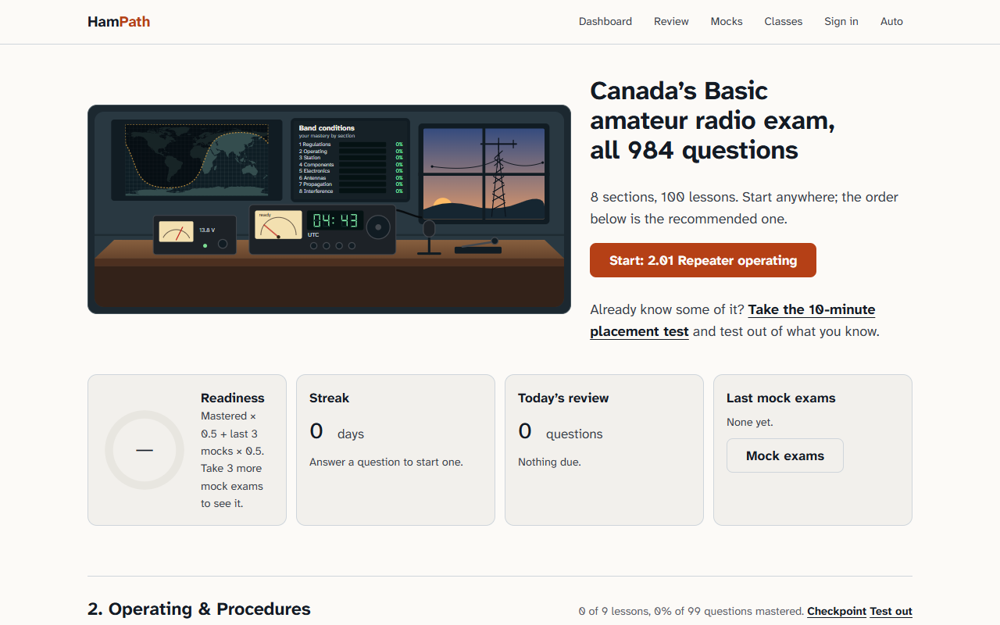
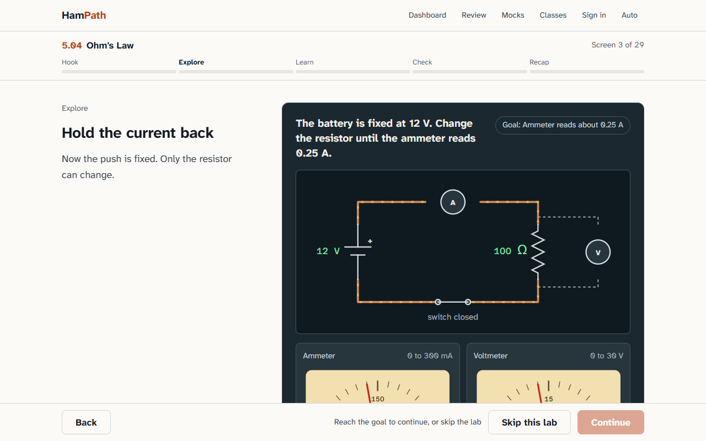

# HamPath

**A free, interactive course for Canada's Basic amateur radio exam.** Live at **[hampath.ca](https://hampath.ca)**.

[](https://github.com/arshmalkana/HamPath/actions/workflows/ci.yml)

Every one of the 984 questions in ISED's Basic Qualification question bank is taught in a short lesson, practised in a hands-on lab and asked in its official wording. No account is needed to start.



## What's in it

- **100 lessons**, one per topic group of the exam. Each lesson runs Hook, Explore (a lab), Learn, Check (every question on that topic) and Recap.
- **35 interactive labs.** Build a circuit and read the meters, tune an antenna for low SWR, raise the radiation angle and watch the skip shrink, key Morse, read the band plan. Labs are optional: you can skip any of them.
- **Explanations for wrong answers.** Every incorrect option has a _Why not?_ note, so a miss teaches you something.
- **Spaced review.** FSRS-5 scheduling brings each question back just before you'd forget it.
- **Mock exams and a readiness score**, plus a 10-minute placement test so you can skip what you already know.
- **Works offline** once a lesson has loaded, and is built for keyboard and screen-reader use (aiming at WCAG 2.2 AA).
- **For classes:** instructors can create a class and run a live quiz.



## Accuracy: help wanted

The course content hasn't yet been reviewed by a licensed amateur. If you're a ham and spot something wrong, misleading or out of date, please [open an issue](https://github.com/arshmalkana/HamPath/issues) with the lesson number (for example `5.04`) and what should change.

The question text itself is never edited: a test checks that every question and answer reaches learners word for word as it appears in the bank file.

## The question bank

`content/bank/amat_basic_quest_delim.txt` is ISED's Basic Qualification question bank, exactly as published (the file's SHA-256 matches ISED's download). The importer is versioned: when ISED publishes a new bank, admins can preview and apply it from `/admin/bank`, and past answers keep the wording the learner saw.

HamPath is an independent study tool. It isn't affiliated with or endorsed by Innovation, Science and Economic Development Canada (ISED). Book the real exam through ISED or an accredited examiner.

## Run it locally

Needs Node 22+ and Docker. pnpm is pinned in `package.json`; if you don't have it, prefix commands with `npx pnpm@10.34.9`.

```sh
pnpm install
cp .env.example .env
pnpm dev
```

`pnpm dev` starts Postgres and Mailpit in Docker, applies migrations, loads the database (seed, question bank, lesson content), then runs the API and the web app:

| What                    | Where                                                                   |
| ----------------------- | ----------------------------------------------------------------------- |
| Web app                 | http://localhost:3000                                                   |
| A full lesson           | http://localhost:3000/lessons/5.04 (Ohm's Law)                          |
| Component gallery       | http://localhost:3000/dev/components                                    |
| API                     | http://127.0.0.1:4000/api/v1 (the web app proxies `/api/*` to it)       |
| Dev inbox (magic links) | http://localhost:8025                                                   |
| Postgres                | `127.0.0.1:5433` (5433 so it doesn't clash with another local Postgres) |

The offline service worker runs only in production builds. In dev you can opt in with `localStorage.setItem("hp-sw", "1")`.

## How it's built

A pnpm monorepo in TypeScript throughout.

```
apps/web          Next.js (App Router) + React: course map, lesson player, labs, review, mocks, admin
apps/api          Fastify + Zod: grading, FSRS scheduling, mastery, auth, readiness, analytics, bank updates
packages/db       PostgreSQL 16 schema (Drizzle), SQL migrations, seed, bank importer, content loader
packages/ham-sim  The maths and physics behind every lab and calculation, shared by browser, API and CI
packages/ui       Design system: light and dark themes, the "shack" skin, keyboard-operable instruments
packages/content  Bank parser, content checks, coverage reports, mock-exam blueprint
content/          Source of truth: the bank, lesson YAML and MDX cards, labs, Why not? notes
docs/             Spec, phase notes, accessibility, performance, security, deployment, coverage
```

Some decisions worth knowing:

- **Answers never reach the browser early.** Question payloads carry opaque option ids, and grading happens on the server. In a lesson's Check, a first wrong answer shows the _Why not?_ note and a second try; the answer is revealed on the second try, straight away in review, and at the end of a mock exam.
- **Lab goals are re-checked on the server** from the lab's inputs, using the same `ham-sim` code the browser runs. CI also checks every calculation in the lessons against the bank's official answers.
- **The bank is versioned.** A changed option is retired and replaced, never edited, so past attempts keep their text.
- **Scheduling is FSRS-5** (correct = Good, wrong = Again, 90% target retention). A question counts as mastered when it's answered correctly twice in a row on separate days, the second time outside the lesson Check.
- **Readiness** is mastery × 0.5 + the average of the last 3 mock exams × 0.5, and shows once 3 mocks are done. The mock blueprint (`content/exam-blueprint.yaml`) uses placeholder section weights until ISED's exam specification is confirmed.
- **Sign-in** starts everyone as a guest; an e-mail magic link or Google sign-in upgrades the guest and keeps their progress.
- **Drizzle, not Prisma:** the schema needs partial unique indexes, check constraints, citext and an append-only trigger. Drizzle generates plain, reviewable SQL and stays a thin layer over `pg`.

## Commands

| Command                                          | Does                                                                                     |
| ------------------------------------------------ | ---------------------------------------------------------------------------------------- |
| `pnpm dev`                                       | Everything above                                                                         |
| `pnpm test`                                      | All Vitest suites. Builds a throwaway `hampath_test` database first (needs `pnpm db:up`) |
| `pnpm lint` / `pnpm format`                      | ESLint / Prettier                                                                        |
| `pnpm typecheck`                                 | `tsc` in every package                                                                   |
| `pnpm check:coverage`                            | Content checks and the launch gate: all 984 questions, 100 lessons, 35 labs              |
| `pnpm coverage`                                  | Regenerate `docs/coverage/` from the bank and `content/`                                 |
| `pnpm build`                                     | Production build of the web app                                                          |
| `pnpm db:setup` / `pnpm db:reset`                | Migrate, seed, import and load content / the same on a fresh volume                      |
| `pnpm import:bank [file] [-- --dry-run]`         | Import an ISED bank file and print what changed                                          |
| `pnpm db:generate`                               | Generate a migration after editing `packages/db/src/schema.ts`                           |
| `pnpm db:make-admin <email> [admin\|instructor]` | Give a signed-in account the admin or instructor role                                    |

## Writing or fixing a lesson

Each lesson is a folder such as `content/sections/05-electronics/lessons/5.04-ohms-law/`:

- `lesson.yaml`: the lesson's question ids, and any calculations (checked against the bank in CI);
- `cards/*.mdx`: the cards, in filename order, each listing the questions it `teaches:`;
- `lab.json`: the lab steps, with their settings, goal and hints;
- `why-not.yaml`: one note per wrong option, keyed by the option's exact text.

`pnpm check:coverage` tells you what's missing, and `pnpm dev` reloads content on every start.

## CI and deployment

GitHub Actions runs the content checks, lint, formatting, types, a dependency audit, the tests against Postgres, the production build and both Docker images on every push and pull request. When CI passes on `main`, a self-hosted runner deploys the Docker stack. See [docs/DEPLOY.md](docs/DEPLOY.md) for running your own copy, and [docs/SECURITY.md](docs/SECURITY.md) for the security model.
